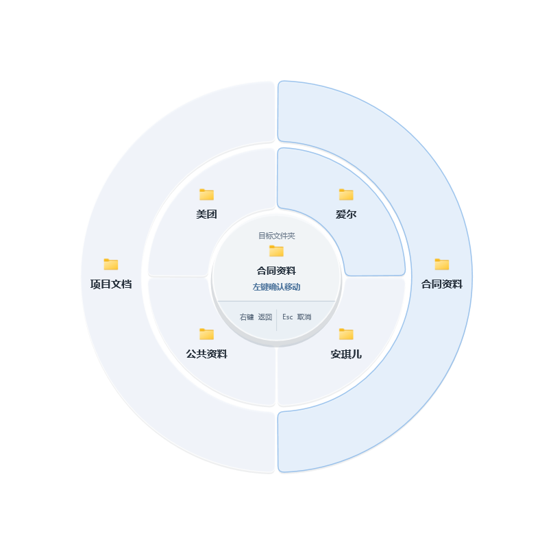
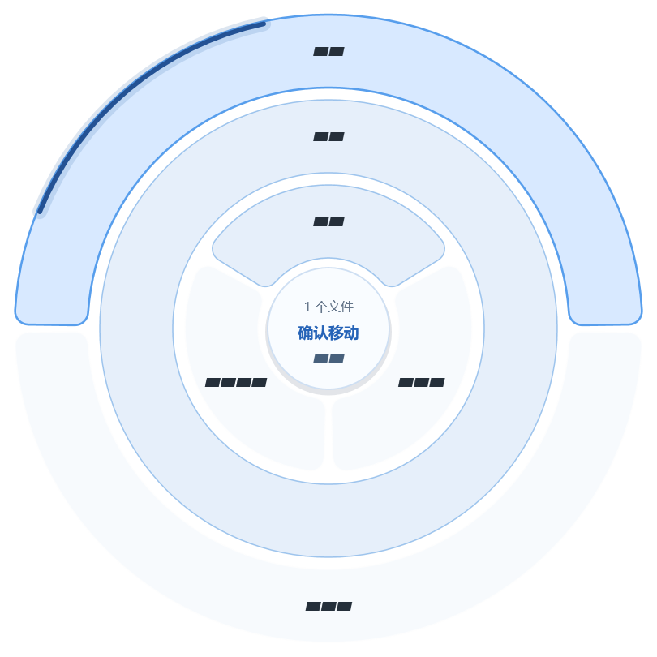

<p align="center">
  
</p>

<h1 align="center">灵环·文件快速整理</h1>

<p align="center">在桌面或文件资源管理器中，用鼠标中键呼出同心圆目录轮盘，把文件和文件夹快速移动到归档目录。</p>

## 操作演示

<p align="center">
  
</p>

<p align="center">鼠标中键呼出灵环，选择目标目录，一步完成文件移动。</p>

## 下载

当前版本：**v0.6.3**，适用于 Windows 10 / Windows 11 x64，无需另装 .NET Runtime，也无需激活码。

| 下载方式 | GitHub |
| --- | --- |
| 安装版 | [下载安装程序](https://github.com/wdmhydw/LingRing/releases/download/v0.6.3/LingRing-0.6.3-windows-x64-setup.exe) |
| 便携版 | [下载便携 ZIP](https://github.com/wdmhydw/LingRing/releases/download/v0.6.3/LingRing-0.6.3-windows-x64-portable.zip) |

升级前先从托盘退出旧版，原有默认起点与常用排序会保留。本版未做代码签名；文件校验值随 Release 提供。详见 [0.6.3 更新说明](docs/release-v0.6.3.md)。

## 0.6.3 更新

- **蓝弧进入深层目录**：前两圈停稳展开；第三圈起可以停在名称上阅读，移向外缘深蓝弧线才进入。稍移出再移回即可继续深入，静止时不会连续下钻。
- **边角按实际空间展开**：圆心保持中键位置，每圈按自身半径利用屏幕空间，减少左侧和下方空白；新增外圈时已有内圈保持原位。
- **快速滚动动画修复**：目录读取与缓存结果不再打断滚轮动画，连续过渡逐段衔接，完整圆环的新旧名称平滑交接。
- **排版统一**：目录全部采用相同字号和字重的纯文字，真实圆角；三项三等分、两项二等分、一项占满可用圆环或弧面。长名称停留片刻可查看完整内容。
- **说明与引导同步更新**：保留蓝灰风格，打开、聚焦、进退、蓝弧呼吸和提示均使用统一动效。

## 界面预览

以下为 0.6.3 实际运行截图。目录名称使用打码占位符，不包含真实文件名或本地路径；截图中的遮盖样式不会出现在正常使用中。

<table>
  <tr>
    <td width="58%" align="center"></td>
    <td width="42%" align="center"></td>
  </tr>
  <tr>
    <td align="center">完整同心圆目录轮盘</td>
    <td align="center">左下边角，各圈利用自身可用空间</td>
  </tr>
</table>

<table>
  <tr>
    <td width="58%" align="center"></td>
    <td width="42%" align="center"></td>
  </tr>
  <tr>
    <td align="center">三项、单项、两项按实际数量分布</td>
    <td align="center">单圈也独立适应边角</td>
  </tr>
</table>

<p align="center">
  
  <br>托盘设置菜单
</p>

## 核心功能

- 在桌面或文件资源管理器的文件区域单击中键，以中键点按位置为圆心打开目录轮盘。
- 支持文件、文件夹以及资源管理器多选项目的批量移动。
- 前两圈悬停展开；第三圈起停留只阅读，从内容区移向呼吸蓝弧才进入。每层最多 4 项，滚轮只切换所在圈。
- 圆弧相切圆角、分圈打开与进退交接动效；所有目录统一纯文字、同一字号和字重，短名居中，长名换行或省略，停留片刻可看全名。
- 圆心保持在中键位置；每圈按自己的半径和屏幕剩余空间展开，边角不会统一挤成固定四分之一圆。展开外圈时内圈保持原位。每圈 3 个目录三等分、2 个二等分、1 个占可用整圈或弧面。
- 右键或 `Backspace` 返回上一级，`Esc` 或点击空白处关闭。
- 在目标目录上按 `Ctrl + 左键`，可以即时新建子文件夹并命名。
- 按使用频次自动调整同级目录顺序，常用目标优先出现。
- 目录统一为“此电脑 → 本地磁盘 → 文件夹”的层级；可把任意文件夹设为默认起点，右键仍能逐级退回“此电脑”。
- 下一级目录异步按需读取，不会在启动时扫描所有磁盘；自适应缓存根据电脑内存限制在约 4–24 MB。
- 轮盘默认起点可以在新手引导或托盘菜单中随时更改，旧版固定根目录会自动迁移。
- 高 DPI 界面、托盘菜单、开机自启选项和中文新手引导。

## 使用方法

1. 安装并启动“灵环·文件快速整理”。
2. 在新手引导最后一步保留最高层“此电脑”，或向下选择一个常用文件夹作为轮盘默认起点。
3. 在桌面或文件资源管理器文件区域的文件、文件夹上单击鼠标中键。
4. 前两圈悬停选择，第三级起从内容区移向蓝弧进入。名称显示不全时停留片刻核对完整名称，再左键点击目标扇区移动。

| 操作 | 功能 |
| --- | --- |
| 鼠标中键 | 在鼠标位置打开轮盘 |
| 前两圈悬停 | 停稳约 450 毫秒后展开下一圈 |
| 第三圈起 | 从内容区移向蓝弧，短停约 110 毫秒进入；稍移出蓝弧再移回可继续，动画期间的手势也会保留 |
| 滚轮 | 切换所在圈同级；前两圈停稳约 850 毫秒展开，深层仍需蓝弧 |
| 鼠标左键 | 点击目标扇区直接移动；点击蓝弧不会移动 |
| 鼠标右键 / `Backspace` | 返回上一级 |
| `Ctrl + 鼠标左键` | 在悬停目录中新建子文件夹 |
| `Esc` / 点击空白处 | 关闭轮盘 |
| `F1` | 重新打开操作引导 |

## 安全边界

- 只在 Windows 桌面和文件资源管理器文件列表区域响应中键；浏览器、聊天软件、任务栏、资源管理器工具栏和其他软件的文件选择框不会触发。
- 归档动作是直接移动，不会复制一份副本，也不会覆盖同名项目；重名时自动生成可用名称。
- 目标只能位于当前已就绪的本地固定盘或可移动盘；默认起点只是打开位置，不会阻止你右键返回上级或切换磁盘。
- 禁止把文件夹移动到自身或其子目录。
- 不联网、不读取 API Key，不上传文件名或目录结构。
- 不再安装曾导致资源管理器卡顿的右键 Shell 扩展。

> 左键确认后不会出现第二次确认，也不会加入资源管理器撤销队列。首次使用建议先用测试文件熟悉操作。

## 兼容性提示

- 当前安装版和便携版均为 Windows x64 自包含版本，无需用户另装 .NET Runtime。
- 目录读取不要求安装 Everything 或 Listary；网络映射盘默认不会列入，以免慢速网络访问影响轮盘。
- 如果正在使用 Listary，请在 Listary 的“选项 → 集成”中关闭 Desktop 和 File Explorer 的鼠标中键菜单，避免两个程序同时响应。

## 从源码构建

SDK 固定为 .NET 8.0.422（`global.json`），依赖使用 `packages.lock.json`。

```powershell
$env:WINDIR = $env:SystemRoot
dotnet restore GongSiOrganizer.sln -r win-x64 --locked-mode
dotnet test tests\GongSiOrganizer.Core.Tests\GongSiOrganizer.Core.Tests.csproj -c Release --no-restore
# 提交修改后，从独立干净工作树生成本地试用包：
.\scripts\Build-LocalTrial.ps1
# 已获得发布授权时，以 release 通道构建：
.\scripts\Build-LocalTrial.ps1 -Channel release
```

安装程序使用 [NSIS](https://nsis.sourceforge.io/) 构建，脚本位于 `installer/LingRing.nsi`。

## 文档

- [完整使用说明](docs/同心圆原型使用说明.txt)
- [架构与安全说明](docs/架构与安全说明.md)
- [v0.6.3 更新说明](docs/release-v0.6.3.md)
- [v0.6.3 构建与发行验收](docs/RELEASE_VERIFICATION_0.6.3.md)
- [公开截图脱敏说明](docs/SCREENSHOT_PRIVACY.md)
- [当前验收记录](docs/ACCEPTANCE_LOG.md)
- [v0.5.5 发行说明](docs/release-v0.5.5.md)
- [v0.5.4 发行说明](docs/release-v0.5.4.md)
- [v0.5.3 发行说明](docs/release-v0.5.3.md)
