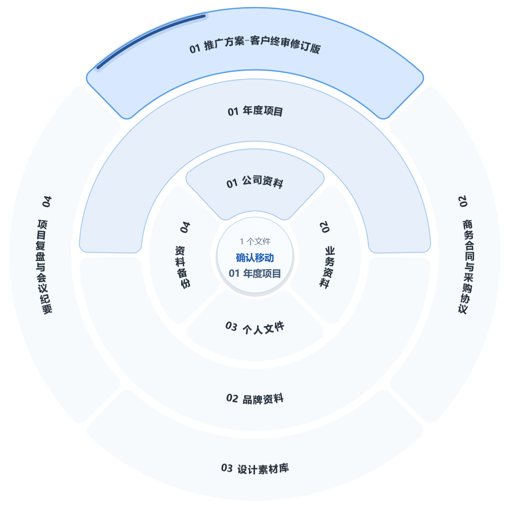

  

<h1 align="center">灵环 · 文件快速整理</h1>

中键打开圆环，选一个目录，完成文件归档。

  <a href="#安装与运行">下载安装</a> ·
  <a href="#快速开始">快速开始</a> ·
  <a href="#文档与支持">文档与支持</a> ·
  <a href="#贡献者">贡献者</a>

  
  

## 用圆环完成归档

灵环常驻系统托盘。在桌面或资源管理器中选中文件，按下鼠标中键，就能在鼠标旁浏览目录并完成移动。

- **读清目录名**：默认沿弧排字、每圈最多 4 项；可切换原版排字，或选择每圈 2–8 项。
- **浏览多层目录**：悬停展开前两圈，移向蓝弧进入更深层；滚轮切换同级，右键返回。
- **整理一组文件**：支持文件、文件夹和多选项目；按使用频次排列目录，也能临时新建文件夹。
- **适应鼠标位置**：圆环在屏幕边角按空间展开；目录按需读取，长名称停留即可查看完整内容。

  
   0.7.0 实际界面 · 默认沿弧排字，每圈最多 4 项

查看完整操作动图

  

动图录制于早期版本，用于演示操作流程；当前排字效果见上方 0.7.0 截图。

## 安装与运行

当前正式版 **[v0.7.0](https://github.com/wdmhydw/LingRing/releases/tag/v0.7.0)**。无需另装 .NET Runtime，无需激活码。

| 下载 | 使用方式 |
| --- | --- |
| **[Windows 安装版](https://github.com/wdmhydw/LingRing/releases/download/v0.7.0/LingRing-0.7.0-windows-x64-setup.exe)** | 按向导安装，可选桌面快捷方式与开机自启 |
| **[Windows 便携版](https://github.com/wdmhydw/LingRing/releases/download/v0.7.0/LingRing-0.7.0-windows-x64-portable.zip)** | 完整解压，运行“灵环·文件快速整理.exe” |

升级前先从托盘退出旧版，原有默认起点与常用排序会保留。本版未做代码签名，发行页提供 [SHA-256 校验文件](https://github.com/wdmhydw/LingRing/releases/download/v0.7.0/SHA256SUMS.txt)。

| 平台 / 架构 | 当前支持 |
| --- | --- |
| Windows 10 / 11 · x64 | 已发布；[构建与包内验收记录](docs/RELEASE_VERIFICATION_0.7.0.md) |
| macOS · Apple Silicon | 当前产品仅面向 Windows，尚无 macOS 安装包 |

## 快速开始

1. **选好起点**：启动后跟随引导，选择常用文件夹；保留“此电脑”也可从磁盘开始浏览。
2. **打开圆环**：在桌面或资源管理器中选中文件，按中键。多选时，在其中一个已选项目上按中键。
3. **选择去向**：前两圈悬停展开，第三圈起移向蓝弧进入；核对目录后，左键点击扇区完成移动。

> 左键确认会直接移动文件，不再弹出第二次确认，也不进入资源管理器撤销队列。首次使用可先打开托盘中的“安全演示”。

| 常用操作 | 作用 |
| --- | --- |
| 滚轮 | 切换鼠标所在圈的同级目录 |
| 右键 / `Backspace` | 返回上一级 |
| `Ctrl` + 左键 | 在目标位置新建文件夹 |
| `Esc` / 点击圆环外空白 | 关闭轮盘 |
| `F1` | 重新查看新手引导 |

**调整显示**：托盘 → **轮盘显示**，选择沿弧 / 原版排字与每圈数量，保存后下次打开生效，重启继续沿用。名称被省略时，停留片刻可查看全名。

**使用提示**：灵环在本机处理文件，不上传目录结构；同名项目自动编号，保留目标目录中的已有文件。默认列出本地固定盘和可移动盘。若使用 Listary，请关闭其 Desktop / File Explorer 中键菜单，避免重复响应。

## 文档与支持

- [完整使用说明](docs/同心圆原型使用说明.txt)：蓝弧导航、键盘操作、设置与移动规则。
- [更新记录与文档索引](docs/README.md)：当前版本变化、历史发行与验证记录。
- [开发与构建](docs/DEVELOPMENT.md)：源码运行、测试和打包入口。
- [反馈问题或建议](https://github.com/wdmhydw/LingRing/issues)：请附版本、操作步骤和预期结果，截图前遮盖私人文件名与路径。

## 贡献者

- **[@wdmhydw](https://github.com/wdmhydw)**：项目维护、产品方向、需求设计与体验验收。
- **Codex / ChatGPT（OpenAI）**：AI 开发协作，参与功能实现、交互与文字排版迭代、性能优化、测试验证和发行文档整理。

历史提交贡献可查看 [GitHub Contributors](https://github.com/wdmhydw/LingRing/graphs/contributors)。

## 许可证

仓库尚未添加独立的 `LICENSE` 文件，使用与分发条款待维护者明确。
